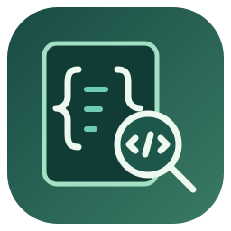
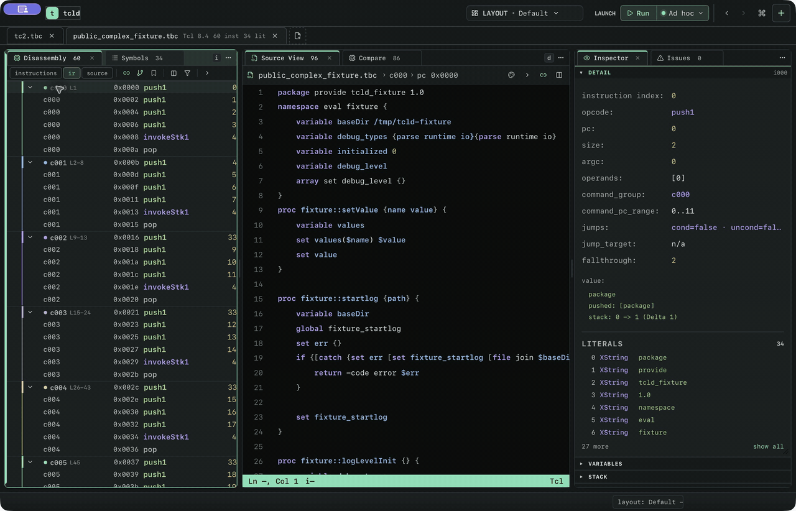
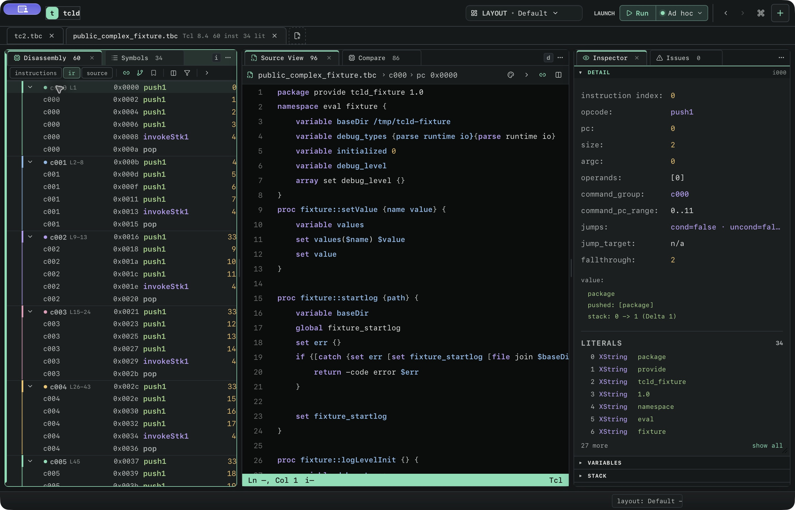

<p align="center"></p>
<h1 align="center">Tcld</h1>
<p align="center"><strong>Recover the source. Follow the bytecode. Understand the program.</strong></p>

[](https://github.com/bryanmatteson/tcld/actions/workflows/ci.yml)
[](LICENSE)


Around the year 2000, TclPro let you compile Tcl scripts into `.tbc` bytecode and
ship them without source. A quarter century later, those `.tbc` files are still
running inside EDA tools, network gear, test harnesses, and lab equipment — and
for many of them, the original source is long gone.

Tcld brings that software into a complete analysis workspace. Recover readable
Tcl, move between instructions and source, inspect symbols and control flow,
and follow execution with a debugger. The native desktop app, terminal
explorer, and CLI share the same analysis of your program.

<p align="center"></p>

A real native session with the bundled public TclPro fixture. Selecting an
instruction follows its reconstructed source and updates the inspector; symbol
navigation and comparison keep the same bytecode context. [Capture recipe and
scripts](docs/assets/README.md).

## A workbench for Tcl software

- 🔎 **Recover and inspect.** Parse Tcl 8.0–9.0 bytecode, resolve operands and
  literals, reconstruct procedures and structured control flow, and keep
  recovery diagnostics attached to the operations they describe.
- 🧭 **Navigate one program through many views.** Raw and grouped disassembly,
  reconstructed source, original source mappings, symbols, literals,
  exceptions, graphs, and an inspector stay linked as you investigate. Filter
  listings, fold command groups, follow jump targets, keep bookmarks, and
  move backward and forward through navigation history.
- 🪟 **Shape your workspace.** Open several files, arrange resizable panels
  and tab stacks, switch between analysis, flow, symbols, trace, console, and
  debug layouts, and save layouts for later sessions. Menus, shortcuts, and a
  command palette bring the same actions to hand.
- 🧩 **Understand reconstruction.** Compare available original source with
  recovered commands and their instruction spans. Inspect basic blocks,
  edges, loops, stack effects, exception ranges, and pipeline traces when you
  need to see how the result was produced.
- 🐞 **Follow a running program.** Breakpoints, step into/over/out, stack
  frames, variables, expressions, watches, and a console work with named run
  configurations. Debug source through a host Tcl interpreter or bytecode
  through the hybrid VM.
- ⚡ **Use the surface that fits.** Analyze interactively in the desktop or
  terminal, or export decompilation, disassembly, dumps, source maps, and
  compatibility reports from scripts. Run bytecode directly with the
  in-process TEBC interpreter.

## From bytecode to source

```
$ tcld disassemble app.tbc              $ tcld decompile app.tbc

 (0) push1 0             # a            set a 1
 (2) push1 1             # 1            return -code ok -level 1 -options {} $a
 (4) storeStk
 (5) pop
 (6) push1 0             # a
 (8) loadStk
 (9) push1 2
(11) returnImm 0 1
(20) done
```

The reconstruction is structural, not a stack-trace dump. Loops, `switch`,
`catch`, namespaces, and procedure bodies come back as idiomatic Tcl:

```tcl
proc fixture::logLevelInit {} {
    variable debug_types
    variable debug_level
    variable initialized
    foreach el $debug_types {
        set tvar "FIXTURE_LOG_LEVEL_$el"
        if {[info exists "::env($tvar)"]} {
            set debug_level($el) $::env($tvar)
        } else {
            set debug_level($el) 0
        }
        fixture::setValue "debug_level_$el" $debug_level($el)
    }
    ...
}
```

*(actual `tcld decompile` output from the bundled fixture)*

When an exact reconstruction isn't possible, `tcld` says so: diagnostics
identify each approximated operation, its bytecode range when known, and the
reason — no silent guesses.

## The desktop workbench

Disassembly, Source View, and Inspector form the core investigation loop.
Grouped instruction rails connect recovered Tcl commands to their real PCs;
selecting a symbol or instruction brings the matching source and metadata
into view. Jump arrows and control-flow graphs expose relationships that are
hard to see in a linear listing.



Switch to Symbols for procedures, namespaces, and variables, or use Compare to
inspect source-to-bytecode mappings. Specialized layouts bring graphs,
exceptions, diagnostics, traces, or debugger controls forward. Panel tabs,
folding, filters, column controls, and linked-navigation toggles let you tune
how much context stays visible.

The app loads `.tbc` artifacts and Tcl sources or wrappers. Run configurations
keep the interpreter/backend, arguments, working directory, environment, and
debug options with the launch you use. Debug layouts bring the source,
variables, stack, breakpoints, and console together.

To build the embedded desktop app from source, install the frontend dependencies
and provide the [Tcl development libraries](third_party/tcl/README.md), then:

```bash
npm ci --prefix apps/tcld-gui
npm run build --prefix apps/tcld-gui
cargo build --release -p tcld-tauri --features tauri/custom-protocol
./target/release/tcld-tauri
```

For platform bundles, use the Tauri CLI from `apps/tcld-tauri` (`cargo tauri
build`). The `hybrid` feature additionally enables direct bytecode execution
and debugging in the desktop host.

<details>
<summary>The terminal explorer</summary>

`tcld explore` opens instructions, literals, exceptions, reconstructed source,
and source maps as synchronized views in your terminal. The inspector follows
the cursor as you move among them.


This is an actual session recorded with VHS from [docs/demo.tape](docs/demo.tape).

</details>

## Quick start

You need stable Rust (the toolchain is pinned in `rust-toolchain.toml`). The
default CLI build has **no Tcl dependency**:

```bash
cargo build --release -p tcld
```

Then point it at a `.tbc` file:

```bash
tcld decompile path/to/file.tbc     # reconstruct Tcl source
tcld disassemble path/to/file.tbc   # linear instruction listing
tcld dump path/to/file.tbc          # exceptions, literals, instructions
tcld explore path/to/file.tbc       # interactive terminal explorer
tcld source-map path/to/file.tbc    # bytecode ↔ source span mapping
tcld coverage report                # opcode × Tcl-version support matrix
```

Try it immediately on the bundled fixture:

```bash
tcld decompile testing/fixtures/public/public_complex_fixture.tbc
```

Batch output is ANSI-colored when stdout is a terminal and plain when
redirected; `--no-colors` or `NO_COLOR=1` disables color explicitly.

## Debugging and running

**Debug Tcl source** through a host interpreter — no special build needed.
`tcld` discovers Tcl 9.0, 8.6, or 8.5 at runtime and injects the matching
debugger nub:

```bash
tcld debug path/to/script.tcl
tcld debug --tclsh /usr/local/bin/tclsh9.0 path/to/script.tcl
```

**Run or debug bytecode directly** with the hybrid TEBC virtual machine, an
in-process bytecode interpreter with an optional bridge to an embedded Tcl 9
host. This build links Tcl 9 (set `TCL9_PREFIX` if it's outside the system
search path):

```bash
cargo build --release -p tcld --features hybrid

tcld run path/to/file.tbc
tcld run --backend=vm-strict path/to/file.tbc   # sandboxed: denies host calls
tcld debug path/to/file.tbc                     # breakpoints at real bytecode PCs
```

`vm-strict` denies all WorldHost calls. The regular hybrid backend can reach
Tcl commands such as `load` and `exec` — use strict mode for untrusted
bytecode.

There's also a middle path: `tcld debug --backend=host file.tbc` reconstructs
the source into a temporary file and debugs that through a host `tclsh`. It
requires an exact reconstruction and reports diagnostics when one isn't
possible.

A binary built without `--features hybrid` reports `hybrid_unavailable` (exit
code 3) when a hybrid backend is requested.

## How it works

Every application layer — CLI, terminal explorer, desktop app, debugger —
consumes one canonical analysis snapshot: load provenance, metadata,
instructions, literals, exception ranges, basic blocks, trace frames,
reconstructed source, source mappings, diagnostics, coverage data, and dump
text. Analyze once, view everywhere.

```
tcld/
├── crates/
│   ├── tcld-core/       # Bytecode parser and instruction tables
│   ├── tcld-ir/         # Intermediate representation and control-flow graph
│   ├── tcld-syntax/     # Tcl parsing, extraction, and highlighting (Tree-sitter)
│   ├── tcld-decompile/  # Reconstruction pipeline; owns the canonical snapshot
│   ├── tcld-explore/    # Explorer domain model
│   ├── tcld-tui/        # Generic terminal framework
│   ├── tcld-vm/         # Hybrid TEBC runtime
│   └── tcld-debug-*/    # Debugger state, wire protocol, Tcl FFI boundary
├── apps/
│   ├── tcld/            # Command-line interface
│   ├── tcld-tauri/      # Desktop backend
│   └── tcld-gui/        # Desktop frontend
└── testing/
    ├── fixtures/        # Public compatibility fixtures
    └── fuzz/            # Fuzz targets and seed corpora
```

Compatibility is tracked opcode by opcode across Tcl versions — `tcld coverage
report` prints the full matrix, classifying each opcode as golden-tested,
structurally recovered, or rendered. The golden decompiler suite covers 37
bytecode fixtures spanning control flow, exception handling, and procedure
reconstruction, and the parser and decompiler are fuzzed continuously.

Release archives ship loadable debugger nubs for Tcl 8.6 and 9.0 (plus 8.5
where the target supports it), validated against an ABI/protocol/checksum
manifest before spawn. [COMPAT.md](COMPAT.md) describes the contract.

## Stability

During the 0.x series:

- `decompile` and `disassemble` output shapes and process exit codes are
  **stable**
- Coverage TSV columns, dump output, explorer session files, debugger commands,
  and the wire protocol may change between minor releases

The wire protocol carries its own version in the handshake.

## Development

```bash
# Rust workspace
cargo fmt --all --check
cargo test --workspace

# Explorer render contracts (deterministic frame snapshots)
cargo test -p tcld --test explore_dump_screen_contract

# Terminal lifecycle checks
scripts/explore-pty-smoke.sh
scripts/debug-pty-smoke.sh

# Hybrid VM gates (requires Tcl 9 headers)
scripts/verify-hybrid-gates.sh
scripts/verify-hybrid-corpus.sh

# Desktop frontend
cd apps/tcld-gui && npm ci && npm test && npm run build
```

## License

Copyright 2026 Bryan Matteson. Licensed under the
[Apache License, Version 2.0](LICENSE). Redistributed TclPro fixtures retain
their original notices; see
[THIRD_PARTY_NOTICES.md](THIRD_PARTY_NOTICES.md).


The mapped debugger also supports real Tcl `coroutine`, `yield`, and `yieldto`.
Its NRE adapter returns to Tcl before suspending, preserving each coroutine's
source frames, local variables, command completions and code-qualified breakpoints.
Runtime-generated and sourced bodies remain inspectable. `yieldto` targets run
in the caller's variable context; nested coroutine transfers, resume values,
execution traces, deletion and errors are checked against the embedded interpreter.
The browser build uses this same adapter with the real Tcl runtime in its isolated
worker; its existing memory, filesystem, output and watchdog limits still apply.

The mapped debugger supports `try` with native Tcl `on`, `trap`, shared handler
bodies and `finally`. Tcl owns validation, handler matching, variable bindings and
completion precedence, including nested `-during` options. Executed scripts gain
source images and caller links, instruction stepping, breakpoints and editable
live locals. Native NRE continuations retain pending cleanup across coroutine
suspension and run it before a pending tail target. Deleting a coroutine follows
Tcl's rewind semantics: it releases suspended state without running a pending
`finally`. The native entry accepts only the exact single-use mapped request;
calling the internal command cannot bypass source admission.


`switch` and `lmap` use the same native NRE control adapter. Tcl owns switch
selection (exact/glob/regexp, captures, fallthrough and defaults), and lmap's
parallel iteration, variable bindings, padding and result collection. Selected
branches and each lmap iteration enter mapped source frames, including bodies
constructed at runtime. The exact captured text and caller links remain
inspectable; code-qualified breakpoints persist across iterations and live-local
edits affect the real ongoing operation. Traces, break/continue, errors, pending
tail calls and coroutine suspension retain native Tcl behavior. Restart discards
suspended continuations and their retained repeated-body templates.


`subst` maps command substitutions, including those inside array indices and
runtime-built templates. Tcl's own public parsers locate command/variable tokens;
the real substitution engine retains flag handling, escapes, variable traces,
completion semantics and deferred parse errors. Exact command source, bytecode,
caller links and live locals remain inspectable and editable. `time` invokes the
native Tcl timing command over a repeated mapped body, retaining the same source
identity and breakpoints on each iteration. Timing includes debugger pauses and
instrumentation. Native Tcl's restriction on yielding across time's C evaluator
frame remains; debugger instruction stepping and suspension are supported.

`apply` delegates lambda validation, formal/default/variadic argument binding,
namespace resolution and procedure completion to native Tcl. Its body is a
mapped source continuation, retaining exact runtime-generated text, its caller,
breakpoints and live locals across native coroutine suspension. Tcl closures
use ordinary command prefixes/explicit captured arguments or namespace state;
no implicit lexical capture is added. No temporary named procedures are created.


`dict for`, `dict map`, `dict update`, and `dict with` also delegate iteration,
key selection, binding, write-back and completion handling to native Tcl. Their
literal or generated bodies have source images, caller links, instruction
stepping, reusable breakpoints and live variable edits across coroutine yields.
`dict with` resolves its native frame's variables lazily to the mapped caller's
storage: Tcl reads the dictionary and discovers keys itself, without a second
read that could duplicate traces or observe a different value. Its native
finalizer still owns write-back, missing variables, nested paths and error
precedence. `dict filter ... script` also maps literal/generated predicates,
including computed subcommands and filter modes. Its native C adapter ports Tcl's
synchronous filter loop to Tcl NRE continuations: Tcl's dictionary APIs, variable
bindings and boolean conversion retain original pairs/order, traces and completion
semantics while allowing real coroutine suspension. Predicate edits affect which
pairs are selected; changing bound keys/values does not rewrite selected pairs.
Key/value glob modes keep their upstream implementation. This extends stock Tcl's
filter, whose recursive C evaluator prevents coroutine yields.
